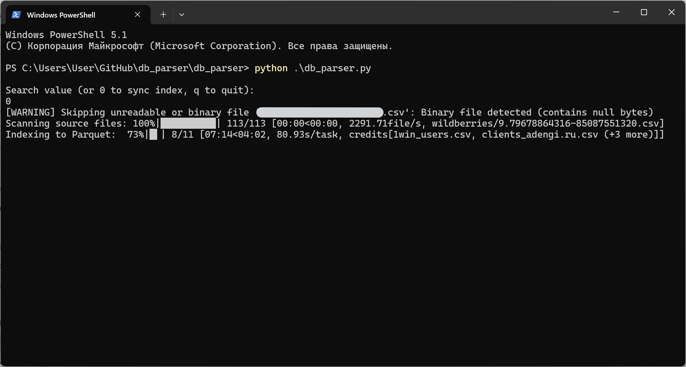

# db_parser

 Database dump parser with high-speed local search & compression

  

## Features

- High-speed local search
- CSV/TSV/TXT/JSON support
- Parquet index manager
- DuckDB
- ZSTD compression
- AES-GCM encryption
- Multi-core support

## Setup

 Just extract the database dumps to any directory and specify it in file [config.py](/db_parser/config.py) (DB_PATH)

All settings are located in `config.py`:

| Parameter | Default | Description |
| --- | --- | --- |
| `DB_PATH` | `~/databases` | Root directory containing database subfolders |
| `PARQUET_DIR` | `parquet_store` | Directory for storing compressed/encrypted Parquet files and manifest |
| `REPORT_FILE` | `report.txt` | Output log file for search results |
| `MERGE_FOLDER_PARQUET` | `True` | Merge all files within a database folder into a single `.eparquet` / `.parquet` file |
| `STREAM_CHUNK_LINES` | `250_000` | Line buffer size for streaming normalization |
| `TEXT_CHECK_BYTES` | `8192` | Header sample size for binary and encoding detection |
| `MAX_CHAOS_THRESHOLD` | `0.5` | Maximum `charset-normalizer` chaos score allowed for text files |
| `COMPRESSION_CODEC` | `ZSTD` | Parquet compression codec |
| `COMPRESSION_LEVEL` | `9` | Parquet compression level |
| `ENCRYPT_INDEX` | `True` | Enable AES-GCM encryption for Parquet files and manifest |
| `ENCRYPTION_PASSWORD` | `DB_PARSER_KEY` env var | Master password for index encryption |
| `SUPPORTED_EXTENSIONS` | `{".csv", ".tsv", ".txt", ".json", ".jsonl"}` | Allowed file extensions during directory scans |

Set the encryption password in PowerShell before running:

```powershell
$env:DB_PARSER_KEY = "password"
```

## Remarks

> [!CAUTION]
 > This project does not contain personal data of any people. The examples above, including database dump names and obfuscated content fragments, are provided solely as an example as possible content to be processed by the utility.

> [!NOTE]
> The utility supports acceleration due to multi-core mode support, while the identification and utilization of the maximum available number of processor cores is performed in automatic mode. Automatic transliteration of full name is also supported (only Russian language for now).

## Usage

### Interactive Mode

Run without arguments to launch the interactive search loop:

```powershell
python db_parser.py
```

- Enter a search value and select the search type (`1` - `NAME`, `2` - `PHONE`, `3` - `EMAIL`, `4` - `BIRTHDAY`).
- Enter `0` to synchronize the Parquet index with `DB_PATH`.
- Enter `q` to exit.

### Synchronize Index (`sync`)

Scan `DB_PATH` for new or modified files, normalize text to UTF-8, and update the Parquet store:

```powershell
python db_parser.py sync
```

### List Indexed Databases and Tables (`list`)

Display all indexed databases, Parquet files, source tables, file sizes, and detected encodings:

```powershell
python db_parser.py list
```

### Search (`search`)

Run a search query directly from the command line and append results to `report.txt`:

```powershell
python db_parser.py search "Ivanov Ivan" --type name
python db_parser.py search "+79991234567" --type phone
python db_parser.py search "user@example.com" --type email
python db_parser.py search "01.01.1990" --type birthday
```

Options:

- `value`: Search string (required).
- `-t`, `--type`: Search mode (`name`, `phone`, `email`, `birthday`; default: `name`).

### Add Database or Table (`add`)

Import an external file or directory into the index:

```powershell
# Add a single file to an existing or new database
python db_parser.py add "D:\dumps\part2.csv" --db clients

# Add an entire folder (uses folder name as DB name if --db is omitted)
python db_parser.py add "D:\dumps\new_leak_folder"
```

Options:

- `path`: Path to a source file or directory (required).
- `--db`: Target database name (optional; defaults to parent folder name for files or directory name for folders).

### Remove Database or Table (`remove`)

Remove an entire database or a specific source table from the index:

```powershell
# Remove a single table and rebuild the merged Parquet file without it
python db_parser.py remove --db clients --table "part2.csv"

# Remove an entire database from the index
python db_parser.py remove --db clients
```

Options:

- `--db`: Database name (required).
- `--table`: Specific source filename to remove (optional; omits to delete the entire database).

### Change Encryption Password (`passwd`)

Re-encrypt all `.eparquet` files and `manifest.enc` with a new password:

```powershell
# Interactive password prompt
python db_parser.py passwd

# Non-interactive mode
python db_parser.py passwd --old-password "old-secret" --new-password "new-secret"
```
